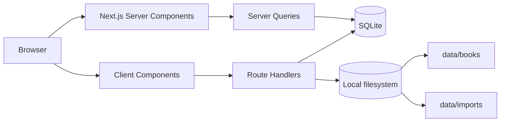

# AstraReader 产品与架构设计

## 目标与范围

AstraReader 是单用户、本地自托管的网页电子书阅读器。核心目标是让个人书库易于管理、阅读状态可靠持久化，并能在电脑、平板和手机之间共享书库和进度。

当前支持：

- TXT、EPUB 导入和阅读。
- EPUB 封面、元数据、嵌套目录、CFI 进度和基于可见 Range 的位置恢复。
- TXT 编码检测、章节识别、字符偏移和分页恢复。
- 书内搜索、书签、进度续读、最近阅读和按日阅读时长。
- 全局主题、字体、字号、行距、段距、版心、对齐和翻页方式。
- 分页阅读与上下滚动阅读，支持键盘、工具栏和触控操作。
- 局域网免登录访问。

明确不支持：

- PDF、MOBI、AZW3、DRM。
- 批注、笔记、TTS、OCR。
- 用户、权限、公网部署、HTTPS 和云同步。
- 自定义字体上传、自动备份和回收站。

## 架构



应用使用单个 Next.js Node.js 进程：

- Server Component 直接读取 SQLite，提供书库和阅读页初始数据。
- Client Component 负责导入、阅读器、目录、设置、编辑和删除交互。
- Route Handler 提供上传、文件流、进度、书签、统计和元数据接口。
- SQLite 保存结构化数据，文件系统保存原始书籍、封面和 EPUB 缓存。
- 生产环境通过 `next build` 和 `next start --hostname 0.0.0.0` 自托管。

Next.js 页面和 API 均使用 Node.js runtime，不使用静态导出或 Edge runtime。

## 代码结构

```text
src/app/                 页面、布局和 Route Handlers
src/components/library/  书库、导入、元数据和删除对话框
src/components/reader/   阅读器外壳、TXT、EPUB、主题和目录
src/lib/import/          浏览器端解析、封面、哈希和上传
src/lib/reader/          阅读设置、主题、TXT 与 EPUB 引擎
src/server/              SQLite、文件路径、查询、写入和 HTTP 工具
src/shared/              公共类型和 Zod schema
data/                    运行时数据，不进入 Git
docs/                    项目文档
```

`src/server/**` 必须包含 `server-only`，不能被 Client Component 导入。

## 导入与删除

导入流程：

1. 浏览器读取文件并计算 SHA-256。
2. EPUB.js 解析 OPF 元数据、目录和封面；TXT 检测 UTF-8、UTF-16、GB18030 或 Big5。
3. 浏览器把封面缩放为 WebP。
4. 通过哈希查重。
5. `POST /api/uploads/book` 使用原始字节流上传，服务端写临时文件并同步计算哈希。
6. `POST /api/books` 校验元数据、哈希和 EPUB 容器后，原子移动到书库并写 SQLite。
7. 失败或断流时删除临时文件；超过 24 小时的未完成上传会被清理。

删除时先把书籍目录移动到临时回收路径，数据库事务成功后再永久删除。首版没有用户可见回收站。

## 阅读器抽象

公共 `ReaderHandle` 统一暴露：

- `next`、`previous`、`goTo`。
- `getLocation`。
- `search`。

格式组件接收 `ReaderViewProps`，并上报当前位置、目录和错误。阅读器外壳统一负责工具栏、目录抽屉、搜索、书签、进度保存、阅读时长和键盘的父页面处理。

## EPUB 实现

EPUB 正文渲染使用 Foliate.js，导入阶段仍使用 EPUB.js 读取 OPF 元数据和封面。
这一分工保留了现有导入流程，同时把分页、滚动和位置锚定交给更专注的阅读渲染器。

分页模式将 Foliate 的 `flow` 设为 `paginated`，限制为单列，并用百分比 `gap`
提供正文左右安全边距；上下滚动模式切换为 `scrolled`。切换阅读方式时不重新
打开图书，分页器会以当前可见 Range 重新渲染。

### 为什么不再修补 EPUB.js 分页

旧实现通过改写 EPUB.js 0.3.93 的私有 `Layout.calculate()` 字段修正单栏页步，
然后在每次翻页前扫描整个 DOM 的文本矩形判断是否“越界”。这条路径有三个结构性
风险：

1. 单栏 `calculate()` 本身不会把传入的 `gap` 换算到 `columnWidth`，修正依赖
   私有字段和内部调用顺序。
2. 全 DOM 矩形扫描既不是逐页可见内容比对，也容易把合法浮动、图片或浏览器小数
   像素判成错误，从而出现正文正常却提示“分栏完整性校验失败”。
3. CFI 只描述文档节点位置，同一章节内的多个分页列可能共享相同 CFI，不能再额外
   用父容器滚动偏移猜测页边界。

Foliate.js 的分页器自行维护页容器、可见 Range 和锚点。翻页、重排与模式切换
都以 Range 为准，不依赖 AstraReader 修改第三方内部布局字段。

关键行为：

- 首次打开且没有保存进度时从 EPUB 书脊第一项开始，因此会显示封面或扉页。
- 已有有效 CFI 时按原位置恢复，包括保存位置为封面或前置页的情况。
- 目录来自 Foliate book 的 `toc`，支持嵌套项。
- 搜索使用 Foliate 的全书搜索，支持取消和结果上限。
- 可见文本 Range 会生成 CFI；每次重排后以 Range 锚点维持节内位置。
- 切换书籍和组件卸载时关闭 view、清理事件监听并释放书籍资源。
- XHTML 在写入渲染 iframe 前移除脚本、表单和远程资源，加载后再执行一次 DOM
  加固。
- 切换分页与滚动模式时保留同一个 view。

### 分页不变量

当前实现由 Foliate 计算页宽，AstraReader 只约束阅读列：

```text
flow             = paginated
max-column-count = 1
max-inline-size  = 用户设置版心
gap              = 7%
```

纸张宽度由用户版心设置限制，正文字列内部保留百分比空隙。分页与滚动模式使用
同一个纸张宽度和文字最大行宽，因此切到上下滚动后每行内容不会变少。浏览器原生
滚动条被隐藏，纸张右边缘使用不占布局宽度的悬浮进度滑块。

修改字号、行距、段距或版心时，Foliate 的 paginator 会按当前 Range 锚点重新
分页。Chrome 对复杂 CSS 多栏仍有实现限制，但不会由 AstraReader 再改写第三方
内部页步。

用户行距以带 `!important` 的主题规则应用到 `body` 及全部正文后代，覆盖书籍
自带的段落、class 和行内行高；标题继续使用独立的紧凑行高。

进度按 spine 字节权重和当前节内分页比例计算。最后一个 spine 只有在末页或
滚动到底时才上报 100%；历史 100% 位置会直接恢复到最后一节末尾。

### 键盘

- 焦点在父页面时，由 EPUB 容器处理 `keydown`。
- 焦点进入 EPUB iframe 后，由绑定在该文档上的非 passive `keydown` 处理。
- 两处处理都调用同一组 `next`/`previous` 逻辑。
- 水平方向键、PageUp/PageDown 在两种模式下都只翻一页。
- 上下方向键只在滚动模式下作为滚动操作。

## TXT 实现

- 编码检测优先 BOM，再尝试 UTF-8，随后回退 GB18030、Big5。
- 章节标题支持中英文常见格式；无章节时显示单一“正文”。
- 文本按段落边界分块，使用固定视口 CSS 多栏分页。
- 阅读位置使用 JavaScript UTF-16 字符偏移。
- 字号、窗口或设备变化后重新分页，并通过字符锚点恢复。
- 上下滚动模式复用当前文本块，按视口高度滚动；跨块时从下一块开头继续，返回上一块时定位到上一块末尾。
- 搜索返回绝对字符偏移和章节摘要。

## 主题系统

阅读设置保存在浏览器 `localStorage` 的 `astra-reader:settings:v1`，通过 `useSyncExternalStore` 在组件之间同步。

内置主题：

- 纸白
- 米黄
- 护眼
- 深灰
- VS Code 深灰
- 纯黑
- 自定义背景和文字色

主题通过全局 CSS 变量应用到书架页、阅读正文、目录抽屉和设置面板。VS Code 深灰使用：

```text
background #1e1e1e
foreground #d4d4d4
accent     #007acc
border     #3c3c3c
```

主题偏好按设备保存；书库、进度和书签通过服务端共享。

## 数据模型

| 表 | 作用 |
| --- | --- |
| `books` | 图书元数据、格式、编码、文件路径、封面路径、大小和哈希 |
| `reading_progress` | 每本书一条最新阅读位置和百分比 |
| `bookmarks` | 位置、章节标签、摘要和创建时间 |
| `reading_stats` | 按书籍和本地日期累计阅读秒数 |
| `upload_sessions` | 未完成上传的临时文件和过期时间 |
| `schema_migrations` | 数据库迁移历史 |

数据库启用 WAL、外键和 busy timeout。书籍路径只使用 UUID 和数据库相对路径，并验证最终路径仍在数据根目录内。

## 安全与失败处理

- 没有身份认证；所有安全边界依赖可信局域网。
- 页面通过 `src/proxy.ts` 生成一次性 CSP nonce；EPUB blob iframe 不允许运行
  未带 nonce 的脚本。
- 写接口拒绝跨来源 `Origin`。
- 上传、封面和旧版 locations 接口都有大小限制。
- 原始文件不放在 `public/`，只能通过受控 Route Handler 读取。
- EPUB XHTML/CSS 在渲染前移除脚本、事件属性、`srcdoc`、脚本 URL 和远程资源。
- 动态响应使用 `Cache-Control: no-store`。
- 文件移动、数据库事务和失败回滚优先保证不产生半导入状态。
