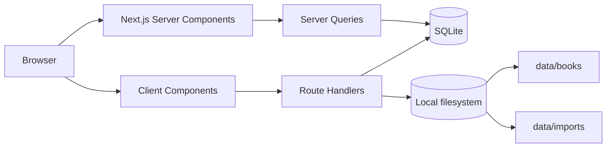

# AstraReader 产品与架构设计

## 目标与范围

AstraReader 是单用户、本地自托管的网页电子书阅读器。核心目标是让个人书库易于管理、阅读状态可靠持久化，并能在电脑、平板和手机之间共享书库和进度。

当前支持：

- TXT、EPUB 导入和阅读。
- EPUB 封面、元数据、嵌套目录、CFI 进度和 locations 缓存。
- TXT 编码检测、章节识别、字符偏移和分页恢复。
- 书内搜索、书签、进度续读、最近阅读和按日阅读时长。
- 全局主题、字体、字号、行距、段距、版心、对齐和翻页动画。
- 局域网免登录访问。

明确不支持：

- PDF、MOBI、AZW3、DRM。
- 批注、笔记、TTS、OCR。
- 用户、权限、公网部署、HTTPS 和云同步。
- 自定义字体上传、自动备份和回收站。

## 架构



应用使用单个 Next.js Node.js 进程：

- Server Component 直接读取 SQLite，提供书库和阅读页初始数据。
- Client Component 负责导入、阅读器、目录、设置、编辑和删除交互。
- Route Handler 提供上传、文件流、进度、书签、统计和元数据接口。
- SQLite 保存结构化数据，文件系统保存原始书籍、封面和 EPUB 缓存。
- 生产环境通过 `next build` 和 `next start --hostname 0.0.0.0` 自托管。

Next.js 页面和 API 均使用 Node.js runtime，不使用静态导出或 Edge runtime。

## 代码结构

```text
src/app/                 页面、布局和 Route Handlers
src/components/library/  书库、导入、元数据和删除对话框
src/components/reader/   阅读器外壳、TXT、EPUB、主题和目录
src/lib/import/          浏览器端解析、封面、哈希和上传
src/lib/reader/          阅读设置、主题、TXT 与 EPUB 引擎
src/server/              SQLite、文件路径、查询、写入和 HTTP 工具
src/shared/              公共类型和 Zod schema
data/                    运行时数据，不进入 Git
docs/                    项目文档
```

`src/server/**` 必须包含 `server-only`，不能被 Client Component 导入。

## 导入与删除

导入流程：

1. 浏览器读取文件并计算 SHA-256。
2. EPUB.js 解析 OPF 元数据、目录和封面；TXT 检测 UTF-8、UTF-16、GB18030 或 Big5。
3. 浏览器把封面缩放为 WebP。
4. 通过哈希查重。
5. `POST /api/uploads/book` 使用原始字节流上传，服务端写临时文件并同步计算哈希。
6. `POST /api/books` 校验元数据、哈希和 EPUB 容器后，原子移动到书库并写 SQLite。
7. 失败或断流时删除临时文件；超过 24 小时的未完成上传会被清理。

删除时先把书籍目录移动到临时回收路径，数据库事务成功后再永久删除。首版没有用户可见回收站。

## 阅读器抽象

公共 `ReaderHandle` 统一暴露：

- `next`、`previous`、`goTo`。
- `getLocation`。
- `search`。

格式组件接收 `ReaderViewProps`，并上报当前位置、目录和错误。阅读器外壳统一负责工具栏、目录抽屉、搜索、书签、进度保存、阅读时长和键盘的父页面处理。

## EPUB 实现

EPUB 使用 `epubjs 0.3.93`，默认分页管理器，`flow: "paginated"`、`spread: "none"`。

关键行为：

- 首次打开跳过封面、目录等前置项，定位到第一个可读正文节点。
- 已有有效 CFI 时优先恢复进度；如果保存位置是封面，则忽略旧前置页进度。
- 目录来自 `book.loaded.navigation`，支持嵌套项。
- 搜索逐章调用 `section.find`，支持取消和结果上限。
- locations 生成后写入 `data/books/<id>/locations.json`，下次直接加载。
- 切换书籍和组件卸载时销毁 rendition、book 并回收 Blob URL。
- EPUB 内嵌脚本被 sandbox 阻止；远程资源被拦截。

### 分页不变量

EPUB.js 的分页步长必须与真实内容列一致：

```text
visible page width = content column width + column gap
```

当前布局中，EPUB.js 会给正文左右各加半个栏间距作为内边距。不要手动把栏间距覆盖为 `0`，否则列步长会小于滚动步长，造成一屏跨两列、左右截断和内容错位。

### 键盘

- 焦点在父页面时，由阅读器外壳的 `window keydown` 处理。
- 焦点进入 EPUB iframe 后，由绑定在该文档上的非 passive `keydown` 处理。
- 两处处理都调用同一组 `next`/`previous` 逻辑。
- 不通过 EPUB.js 的 passive 事件代理调用 `preventDefault`。

## TXT 实现

- 编码检测优先 BOM，再尝试 UTF-8，随后回退 GB18030、Big5。
- 章节标题支持中英文常见格式；无章节时显示单一“正文”。
- 文本按段落边界分块，使用固定视口 CSS 多栏分页。
- 阅读位置使用 JavaScript UTF-16 字符偏移。
- 字号、窗口或设备变化后重新分页，并通过字符锚点恢复。
- 搜索返回绝对字符偏移和章节摘要。

## 主题系统

阅读设置保存在浏览器 `localStorage` 的 `astra-reader:settings:v1`，通过 `useSyncExternalStore` 在组件之间同步。

内置主题：

- 纸白
- 米黄
- 护眼
- 深灰
- VS Code 深灰
- 纯黑
- 自定义背景和文字色

主题通过全局 CSS 变量应用到书架页、阅读正文、目录抽屉和设置面板。VS Code 深灰使用：

```text
background #1e1e1e
foreground #d4d4d4
accent     #007acc
border     #3c3c3c
```

主题偏好按设备保存；书库、进度和书签通过服务端共享。

## 数据模型

| 表 | 作用 |
| --- | --- |
| `books` | 图书元数据、格式、编码、文件路径、封面路径、大小和哈希 |
| `reading_progress` | 每本书一条最新阅读位置和百分比 |
| `bookmarks` | 位置、章节标签、摘要和创建时间 |
| `reading_stats` | 按书籍和本地日期累计阅读秒数 |
| `upload_sessions` | 未完成上传的临时文件和过期时间 |
| `schema_migrations` | 数据库迁移历史 |

数据库启用 WAL、外键和 busy timeout。书籍路径只使用 UUID 和数据库相对路径，并验证最终路径仍在数据根目录内。

## 安全与失败处理

- 没有身份认证；所有安全边界依赖可信局域网。
- 写接口拒绝跨来源 `Origin`。
- 上传、封面和 locations 都有大小限制。
- 原始文件不放在 `public/`，只能通过受控 Route Handler 读取。
- 动态响应使用 `Cache-Control: no-store`。
- 文件移动、数据库事务和失败回滚优先保证不产生半导入状态。
